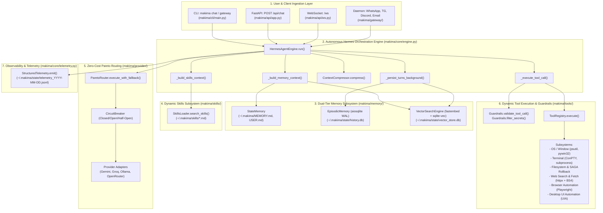
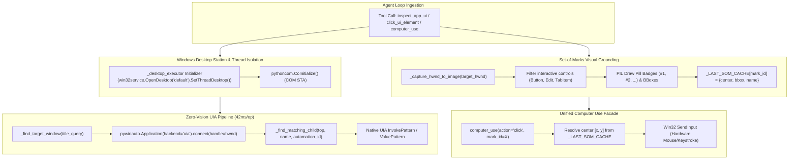
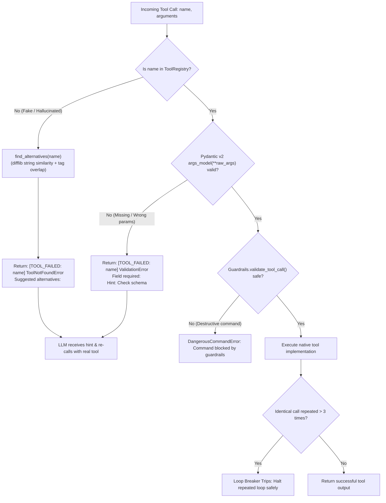

# 🔄 Makima v2 — End-to-End Data Flow & Function Call Architecture

> **Purpose**: Formal reference documenting the complete end-to-end data flow, function calling hierarchy (caller $\rightarrow$ callee), parameter transformations, and asynchronous lifecycle across all subsystems in Makima v2.

---

## 1. High-Level Architecture & Data Flow



---

## 2. Execution Lifecycle: Turn-by-Turn Trace

When a request arrives from any interface (CLI, REST, WebSocket, or Gateway), the execution lifecycle proceeds through **8 strict stages**:

### Stage 1: Request Ingestion & Normalization
- **Callers**:
  - `makima/api/app.py` $\rightarrow$ `chat_endpoint(request, body: ChatRequest)`
  - `makima/api/ws.py` $\rightarrow$ `websocket_endpoint(websocket)`
  - `makima/cli/main.py` $\rightarrow$ `run_turn_interactive(engine, prompt, ...)`
  - `makima/gateway/runner.py` $\rightarrow$ `on_inbound_message(sender, text)`
- **Data In**: Raw user text prompt string and/or pre-existing `List[Dict[str, Any]]` history turns, optional `session_id`, `task`, `temperature`.
- **Transformation**: Validated via Pydantic model (`ChatRequest` or `WSMessage`), converted into canonical `List[Message]` objects:
  ```python
  Message(role="user", content="<prompt>")
  ```
- **Callee**: `HermesAgentEngine.run(prompt=..., messages=..., session_id=...)`

---

### Stage 2: Memory & Skills Context Injection (Pre-Execution)
Before sending anything to the language model, `HermesAgentEngine` enriches the system prompt with long-term memory and matched procedural skills.

1. **State Memory Facts Injection**:
   - **Caller**: `HermesAgentEngine._build_memory_context()`
   - **Callee**: `StateMemory.format_prompt_injection()`
   - **File**: `makima/memory/state.py`
   - **Action**: Reads `~/.makima/USER.md` (user persona, goals) and `MEMORY.md` (architecture facts, durable guidelines).
   - **Output**: Markdown section: `## Long-Term Memory & User Facts...`

2. **Vector Semantic Memory Recall**:
   - **Caller**: `HermesAgentEngine._build_memory_context()`
   - **Callee**: `VectorSearchEngine.search(query=prompt, top_k=5)`
   - **File**: `makima/memory/vector_search.py`
   - **Action**: Generates ONNX MiniLM-L12 vector embeddings (via `fastembed` in `asyncio.to_thread`) and executes KNN cosine similarity search in SQLite `vec0` virtual table.
   - **Output**: Top relevant historical turns formatted as `## Relevant Memory\n- [doc_id] ...`

3. **Active Skills Auto-Injection**:
   - **Caller**: `HermesAgentEngine._build_skills_context()`
   - **Callee**: `SkillsLoader.search_skills(query=prompt)`
   - **File**: `makima/skills/loader.py`
   - **Action**: Queries scanned markdown skill files in `~/.makima/skills/` matching prompt keywords or tags.
   - **Output**: `SkillsLoader.build_system_prompt_section()` injected as: `### Skill: <name>\n<operating instructions>`.

---

### Stage 3: Context Budget & Middle-Turn Compression
- **Caller**: `HermesAgentEngine.run()` (inside while-loop)
- **Callees**:
  - `ContextCompressor.needs_compression(working_messages, system_prompt)`
  - `ContextCompressor.compress(working_messages, system_prompt)`
- **File**: `makima/core/context.py`
- **Logic**:
  1. Counts tokens using heuristics and dynamic token counter.
  2. If token count exceeds configured threshold (e.g. 75% of model window), executes **middle-turn compression**:
     - **Preserves Head**: System prompt + first user goal turn.
     - **Preserves Tail**: Last 3–5 dialogue and tool turns.
     - **Distills Middle**: Middle turns compressed to prevent context blowout while maintaining conversational continuity.

---

### Stage 4: Zero-Cost Pareto Provider Routing
- **Caller**: `HermesAgentEngine.run()`
- **Callee**: `ParetoRouter.execute_with_fallback(task, messages, system_prompt, tools, ...)`
- **File**: `makima/provider/router.py`
- **Routing Sequence**:
  1. **Candidate Ranking**: `get_ranked_candidates(task)` sorts backends by Pareto score:
     $$\text{Score} = \text{CascadeRank} \times 1000 + \text{EWMA Latency} + (\text{Cost} \times 100)$$
     Free and offline local backends (e.g. Ollama `qwen2.5-coder:7b`) are prioritized.
  2. **Circuit Breaker Evaluation**: `CircuitBreaker.can_execute()` verifies the backend is not tripped in `OPEN` state.
  3. **Provider Execution**: Dispatches to `BaseProvider.generate()`:
     - `GeminiProvider`: Google GenAI API (`gemini-2.0-flash`).
     - `OpenAICompatibleProvider`: Groq (`llama-3.3-70b-versatile`), Ollama, OpenRouter.
  4. **Latency Update**: On success, updates Exponentially Weighted Moving Average (EWMA):
     $$S_t = \alpha Y_t + (1 - \alpha) S_{t-1}, \quad \alpha = 0.25$$
  5. **Automatic Cascade Failover**: If primary backend trips (rate limit 429, quota 403, timeout), `CircuitBreaker` records failure and router instantly fails over to next candidate.

---

### Stage 5: Autonomous Tool Dispatch & Dual Guardrails
If the model response contains `tool_calls`:

1. **Safety Interception (Pre-Execution Guard)**:
   - **Caller**: `HermesAgentEngine._execute_tool_call()`
   - **Callee**: `Guardrails.validate_tool_call(tool_name, arguments)`
   - **File**: `makima/core/guardrails.py`
   - **Action**: Inspects terminal commands, SQL statements, and OS calls against regex rules. Intercepts destructive patterns:
     - `rm -rf /`, `rm -rf ..`, `format C:`, `DROP TABLE`, `TRUNCATE`, `diskpart`, `shutdown`.
   - **Outcome**: If dangerous, raises `DangerousCommandError`, formatted as `[GUARDRAIL_BLOCKED: tool_name] <reason>` and fed back to model for self-correction without execution.

2. **Tool Execution**:
   - **Caller**: `HermesAgentEngine._execute_tool_call()`
   - **Callee**: `ToolRegistry.execute(name, arguments)`
   - **File**: `makima/tools/registry.py`
   - **Action**: Resolves registered `@tool` callable, parses arguments via synthesized Pydantic schema, and executes (supporting both sync and async):
     - `web_search(query, max_results)` $\rightarrow$ `httpx` DuckDuckGo HTML scraping.
     - `fetch_page(url, extract_text)` $\rightarrow$ Fast text extraction via `BeautifulSoup4`.
     - `execute_command(command)` $\rightarrow$ Clamped async subprocess / Windows ConPTY.
     - `write_file` / `edit_file` $\rightarrow$ SAGA snapshotting (`makima/tools/filesystem/`).
     - `list_open_windows` / `focus_window` $\rightarrow$ Windows UIA / `pywin32`.
   - **Failure Handling**: If tool raises exception, formats self-healing prompt `[TOOL_FAILED: name] <error>`.

3. **Information Leak Redaction (Post-Execution Guard)**:
   - **Caller**: `HermesAgentEngine._execute_tool_call()`
   - **Callee**: `Guardrails.filter_secrets(result_str)`
   - **Action**: Scans output using Shannon Entropy mathematics and regex to redact accidental API keys, tokens, and credentials.

4. **Telemetry Logging**:
   - Emits `tool.execute` event with latency in milliseconds.

5. **Loop Continuation**:
   - Appends `Message(role="tool", content=result_str)` to history.
   - Loops back to **Stage 3** until model returns final text answer or reaches `max_turns`.

---

### Stage 6: Final Answer Sanitization & Return
- **Caller**: `HermesAgentEngine.run()`
- **Action**:
  - Model returns response with empty `tool_calls` (final answer).
  - Sanitizes output via `Guardrails.filter_secrets(final_content)`.
  - Packages into `EngineResult`:
    ```python
    EngineResult(
        content=sanitized_content,
        messages=working_messages,
        turn_count=turn,
        tool_calls_executed=total_tool_calls,
        completed=True,
        finish_reason="stop",
        model_used=model_name,
        latency_ms=elapsed_ms,
    )
    ```

---

### Stage 7: Background Asynchronous Persistence (Episodic & Vector)
To keep execution latency minimal, persistence is decoupled into a background task:

- **Caller**: `HermesAgentEngine.run()`
- **Task Spawner**: `asyncio.create_task(self._persist_turns_background(session_id, new_msgs, offset))`
  *(Strong reference held in `self._background_tasks` to prevent asyncio GC).*
- **Callees**:
  1. `EpisodicMemory.store_turn(session_id, turn_index, role, content, tool_calls)`:
     - Writes dialogue turn to SQLite database (`~/.makima/state/history.db`) in WAL mode.
     - Updates FTS5 full-text keyword search index.
  2. `VectorSearchEngine.add_document(doc_id, text, metadata)`:
     - Automatically generates 384-dimensional vector embedding for each turn.
     - Inserts into `vector_store.db` `vec0` table for future semantic recall.

---

### Stage 8: Telemetry Event Logging
- **Caller**: All major lifecycle checkpoints
- **Callee**: `StructuredTelemetry.emit()` / `emit_sync()`
- **File**: `makima/core/telemetry.py`
- **Recorded Events**:
  - `engine.run_start`: Logged when run begins with `session_id`, `task`, `prompt`.
  - `tool.execute`: Logged after each tool invocation with `tool` name and `latency_ms`.
  - `tool.blocked`: Logged if Guardrails intercepted a dangerous command.
  - `tool.error`: Logged if a tool raised an uncaught exception.
  - `engine.run_complete`: Logged with total `turn_count`, `tool_calls_executed`, and `latency_ms`.
- **Destination**:
  - Append-only daily rotated JSONL file: `~/.makima/state/telemetry_YYYY-MM-DD.jsonl`.
  - In-memory ring buffer (500 events) queryable via `GET /api/telemetry`.

---

## 3. Comprehensive Caller $\rightarrow$ Callee Matrix

| Caller Module & Function | Callee Module & Function | Input Data Schema | Output Data Schema | Purpose |
|---|---|---|---|---|
| `api/app.py:chat_endpoint()` | `core/engine.py:HermesAgentEngine.run()` | `prompt: str`, `messages: List`, `task: str`, `session_id: str` | `EngineResult` | Dispatches REST chat request to agent loop |
| `api/ws.py:websocket_endpoint()` | `core/engine.py:HermesAgentEngine.run()` | `prompt: str`, `tools: ToolRegistry`, `tool_executor: Callable` | `EngineResult` | Dispatches WebSocket request with streaming tool updates |
| `cli/main.py:run_turn_interactive()` | `core/engine.py:HermesAgentEngine.run()` | `prompt: str`, `messages: List`, `on_turn_end: Callable` | `EngineResult` | Interactive CLI turn execution with Rich spinner |
| `core/engine.py:run()` | `core/engine.py:_build_memory_context()` | `prompt: str`, `session_id: str` | `str` (Markdown context) | Aggregates user profile, facts, and past turns |
| `core/engine.py:_build_memory_context()` | `memory/state.py:StateMemory.format_prompt_injection()` | None | `str` (Markdown) | Reads and formats `MEMORY.md` and `USER.md` |
| `core/engine.py:_build_memory_context()` | `memory/vector_search.py:VectorSearchEngine.search()` | `query: str`, `top_k: int` | `List[Dict[str, Any]]` | Semantic KNN cosine similarity search |
| `core/engine.py:run()` | `core/engine.py:_build_skills_context()` | `prompt: str` | `str` (Markdown) | Finds procedural skills relevant to user prompt |
| `core/engine.py:_build_skills_context()` | `skills/loader.py:SkillsLoader.search_skills()` | `query: str` | `List[Skill]` | Scans markdown files for matching name/tags/body |
| `core/engine.py:_build_skills_context()` | `skills/loader.py:SkillsLoader.build_system_prompt_section()` | `skills: List[Skill]` | `str` (Markdown) | Formats skills into LLM prompt format |
| `core/engine.py:run()` | `core/context.py:ContextCompressor.compress()` | `messages: List[Message]`, `system_prompt: str` | `List[Message]` | Middle-turn pruning when context budget exceeded |
| `core/engine.py:run()` | `provider/router.py:ParetoRouter.execute_with_fallback()` | `task: str`, `messages: List[Message]`, `tools: List[Dict]` | `ProviderResponse` | Pareto frontier model selection & failover |
| `provider/router.py:execute_with_fallback()` | `provider/circuit_breaker.py:CircuitBreaker.can_execute()` | None | `bool` | Verifies provider circuit breaker is not tripped |
| `provider/router.py:execute_with_fallback()` | `provider/adapters/base.py:BaseProvider.generate()` | `messages: List[Message]`, `tools: List[Dict]` | `ProviderResponse` | Invokes LLM vendor API (Gemini/Groq/Ollama) |
| `core/engine.py:run()` | `core/engine.py:_execute_tool_call()` | `call: ToolCall`, `tool_executor: Callable` | `str` (Tool result JSON) | Executes single tool call with guardrails |
| `core/engine.py:_execute_tool_call()` | `core/guardrails.py:Guardrails.validate_tool_call()` | `name: str`, `arguments: dict` | None (Raises `DangerousCommandError`) | Blocks dangerous shell / SQL / OS commands |
| `core/engine.py:_execute_tool_call()` | `tools/registry.py:ToolRegistry.execute()` | `name: str`, `arguments: dict` | `Any` | Invokes registered Python tool function |
| `tools/registry.py:execute()` | `tools/web_search.py:web_search()` | `query: str`, `max_results: int` | `List[Dict[str, str]]` | DuckDuckGo fast HTML search via httpx |
| `tools/registry.py:execute()` | `tools/terminal/runner.py:execute_command()` | `command: str`, `timeout_seconds: int` | `Dict[str, Any]` | Sandboxed subprocess command runner |
| `tools/registry.py:execute()` | `tools/os/windows.py:list_open_windows()` | None | `List[Dict[str, Any]]` | Enumerate desktop windows via pywin32 |
| `tools/registry.py:execute()` | `tools/desktop/uia.py:inspect_app_ui()` | `title_query: str`, `hwnd: int` | `Dict[str, Any]` | Zero-vision UIA control tree inspection |
| `tools/registry.py:execute()` | `tools/desktop/uia.py:click_ui_element()` | `name: str`, `automation_id: str` | `Dict[str, Any]` | Programmatic InvokePattern button clicking |
| `tools/registry.py:execute()` | `tools/desktop/som.py:annotate_window_som()` | `title_query: str`, `max_marks: int` | `Dict[str, Any]` | Set-of-Marks visual marker badge generation |
| `tools/registry.py:execute()` | `tools/desktop/computer_use.py:computer_use()`| `action: str`, `mark_id: int`, `text: str` | `Dict[str, Any]` | Unified computer use action dispatcher |
| `tools/registry.py:execute()` | `tools/desktop/input.py:keyboard_type()` | `text: str`, `delay_ms: float` | `Dict[str, Any]` | Hardware Win32 SendInput Unicode keystrokes |
| `tools/registry.py:execute()` | `tools/os/notifications.py:show_desktop_notification()` | `title: str`, `message: str` | `Dict[str, Any]` | Native WinRT Action Center desktop toast |
| `core/engine.py:run()` | `memory/reflection.py:ImplicitPreferenceLearner.learn_from_turn()` | `user_message: str`, `assistant_response: str` | `str` (Learned pref) | Post-turn autonomous habit extraction |
| `memory/reflection.py:learn_from_turn()` | `memory/state.py:StateMemory.append_user_profile()` | `preference: str` | None | Persists learned preference to `USER.md` |
| `core/engine.py:_execute_tool_call()` | `core/guardrails.py:Guardrails.filter_secrets()` | `result_str: str` | `str` (Sanitized text) | Redacts secrets using Shannon entropy |
| `core/engine.py:run()` | `core/engine.py:_persist_turns_background()` | `session_id: str`, `messages: List[Message]` | None (Background task) | Asynchronously saves dialogue turns to storage |
| `core/engine.py:_persist_turns_background()` | `memory/episodic.py:EpisodicMemory.store_turn()` | `session_id: str`, `turn_index: int`, `content: str` | None | Inserts turn into SQLite WAL database |
| `core/engine.py:_persist_turns_background()` | `memory/vector_search.py:VectorSearchEngine.add_document()` | `doc_id: str`, `text: str`, `metadata: dict` | None | Inserts ONNX embedding into sqlite-vec |
| `core/engine.py:run()` / `_execute_tool_call()` | `core/telemetry.py:StructuredTelemetry.emit_sync()` | `event_type: str`, `data: dict` | None | Appends event to JSONL file and ring buffer |
| `api/app.py:get_telemetry_events()` | `core/telemetry.py:StructuredTelemetry.get_recent()` | `n: int` | `List[Dict[str, Any]]` | Returns recent runtime events for inspection |

---

## 4. Desktop Control & Zero-Vision Automation Data Flow



---

## 5. Fake Tool Call Defense & Self-Healing Data Flow



---

## 6. Subsystem Dependency & Modularity Contract

### OSWorld / Daytona evaluation boundary

```text
OSWorld task + observation -> MakimaOSWorldAgent -> HermesAgentEngine
                                              -> ParetoRouter backend
                                              -> Makima ToolRegistry
                                              -> Daytona / VM-facing tools
```

The benchmark result records the agent as `Makima` and the selected model as
`reasoning_backend`. The provider model must never replace the agent identity.

```
┌────────────────────────────────────────────────────────┐
│                   APIs & Frontends                     │
│         CLI (main.py) | REST (app.py) | WS (ws.py)      │
└───────────────────────────┬────────────────────────────┘
                            │
                            ▼
┌────────────────────────────────────────────────────────┐
│                   HermesAgentEngine                    │
│   (Orchestrates Loop, Compression, and Guardrails)     │
└───────┬──────────────┬──────────────┬───────────┬──────┘
        │              │              │           │
        ▼              ▼              ▼           ▼
┌──────────────┐┌──────────────┐┌───────────┐┌───────────┐
│ ParetoRouter ││ ToolRegistry ││ Dual-Tier ││Telemetry  │
│ (Cascades,   ││ (Discovery,  ││ Memory    ││ (JSONL,   │
│  CircuitBrk) ││  Execution)  ││ (Episodic,││  RingBuf) │
└───────┬──────┘└──────┬───────┘│  Vector,  │└───────────┘
        │              │        │  State)   │
        ▼              ▼        └───────────┘
┌──────────────┐┌──────────────┐
│  Providers   ││ Tool Modules │
│(Gemini, Groq,││ (OS, Terminal│
│ Ollama, etc.)││  Web, Files) │
└──────────────┘└──────────────┘
```

- **Zero Circular Dependencies**: All modules depend downward; `core/engine.py` consumes interfaces through duck typing and dependency injection.
- **Graceful Degradation**: If `VectorSearchEngine` or `StateMemory` are omitted, `HermesAgentEngine` boots and operates without errors.
- **Safety First**: Destructive operations are prevented by `Guardrails` before execution and secrets are scrubbed before LLM observation.
