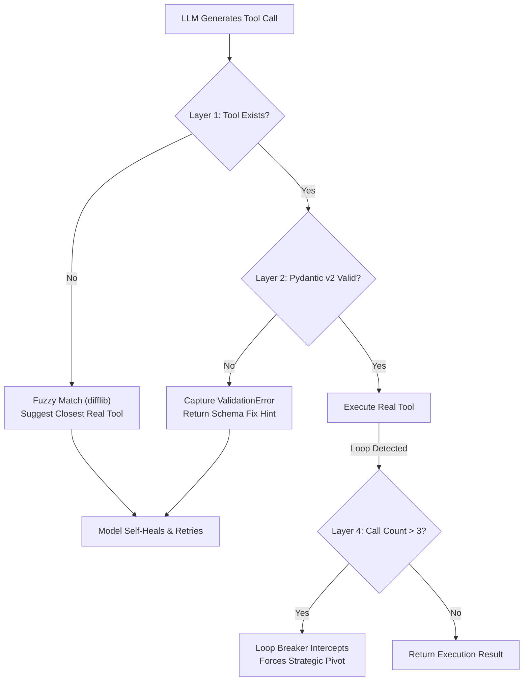

# ⚡ Makima v2 — Battle-Tested Engineering Workflow

> **Core Philosophy**: Extreme rigor, minimal code, zero overengineering. Build only what is explicitly requested. Never hand-roll what libraries, SDKs, OS APIs, or AI models already do natively.

---

## 🔁 The 8-Stage Execution Cycle

Every single change, fix, and feature addition in Makima v2 strictly follows this linear 8-stage sequence:

```mermaid
flowchart LR
    S1["1. Skill Check\n(master-workflow first)"] --> S2["2. Scope & Anti-Bloat\n(no speculative code)"]
    S2 --> S3["3. Library-First Gate\n(stdlib, pip, SDKs, LLM)"]
    S3 --> S4["4. Verify Problem\n(prove gap with test/read)"]
    S4 --> S5["5. Minimal Diff\n(surgical edit + caller audit)"]
    S5 --> S6["6. Live Verification\n(tests/verify_*.py exit 0)"]
    S6 --> S7["7. Dead Code Prune\n(prune imports & dead branches)"]
    S7 --> S8["8. Living Docs Sync\n(TODO, DEVLOG, DATA_FLOW)"]
```



---

### Stage 1: Mandatory Skill-First Execution Protocol
- **Trigger**: Every single model turn or subagent invocation.
- **Rule**: Every response must open with the exact `[SKILL CHECK]` block, with `master-workflow` listed **first** unconditionally:
  ```markdown
  [SKILL CHECK] Task: <one-line summary of what is being asked>
  [SKILL CHECK] Applicable skill(s): master-workflow (consulted first) -> <domain-skills>
  [SKILL CHECK] Loaded in full: yes
  ```
- **Ban**: Jumping straight to code or plans without this gate is an immediate protocol violation.

---

### Stage 2: Scope & Anti-Overengineering Gate (`[SCOPE]`)
- **Rule**: Implement **only** what was explicitly requested.
- **Strictly Banned**:
  - ❌ No future-proof abstractions (base factories, plugin architectures, meta-registries) when a simple concrete implementation suffices.
  - ❌ No heavy custom frameworks (e.g. hand-rolling DAG planning engines when modern LLMs natively reason step-by-step).
  - ❌ No "just in case" parameters or branches.
  - ❌ No temporary TODO stubs (`# TODO: handle later`).
- **Required Gate Block**:
  ```markdown
  [SCOPE] What was explicitly asked: <exact user request>
  [SCOPE] What I will write: <precise minimal scope>
  [SCOPE] What I am leaving out: <speculative things intentionally skipped>
  ```

---

### Stage 3: Library-First & Model-Native Gate (`[LIBRARY CHECK]`)
- **Rule**: Before writing a single line of code, verify whether an existing library, SDK, OS API, or AI model native feature already solves it.
- **The 3-Question Check**:
  1. **Q1 — Python stdlib?** (`pathlib`, `json`, `re`, `asyncio`, `shutil`, `tempfile`, `hashlib`, `math`, `time`).
  2. **Q2 — Installed package?** Check `pyproject.toml` (`pydantic`, `httpx`, `psutil`, `pywin32`, `pywinauto`, `sounddevice`, `aiosqlite`, `fastembed`, `sqlite-vec`).
  3. **Q3 — Model or Makima native?** Does the LLM handle it via prompt/tools? Does `HermesAgentEngine`, `ToolRegistry`, `EpisodicMemory`, or `StateMemory` already provide it?
- **Required Gate Block**:
  ```markdown
  [LIBRARY CHECK] Capability: <what is needed>
  [LIBRARY CHECK] Stdlib check: <result>
  [LIBRARY CHECK] Installed packages check: <result>
  [LIBRARY CHECK] Existing Makima / Model native check: <result>
  [LIBRARY CHECK] Decision: USE EXISTING: <name> OR CREATE NEW because: <gap>
  ```

---

### Stage 4: Verify Before Implement (`[VERIFY]`)
- **Rule**: Never fix or implement based on assumptions. Prove the bug or missing capability first.
- **Order of Proof**:
  1. Run a command/test reproducing the failure (`python tests/verify_*.py`).
  2. Read the source file line-by-line to confirm the code pattern is actually present.
  3. Check `git log -p` and `docs/DEVLOG.md` to ensure the existing behavior was not a deliberate engineering choice.
- **Required Gate Block**:
  ```markdown
  [VERIFY] Claim: <what problem/gap am I addressing>
  [VERIFY] Evidence: <command output / test failure / file trace>
  [VERIFY] Confirmed: yes / no
  ```

---

### Stage 5: Minimal Diff & Caller/Callee Cross-Inspection (`[MINIMAL DIFF]`)
- **Rule**: Make the **smallest possible change** that correctly achieves the goal.
- **Callee + All Callers Mandate**:
  - Never inspect or patch only the target file.
  - Search all callers across the repository (`Select-String -Path "makima/**/*.py" -Pattern "<function_name>"`).
  - Verify parameter signatures, return types, and keyword argument defaults so existing callers experience zero regressions.
- **Required Gate Block**:
  ```markdown
  [MINIMAL DIFF] Exact gap: <one sentence>
  [MINIMAL DIFF] Smallest change: <lines changing and why>
  [MINIMAL DIFF] What is left untouched: <everything else>
  ```

---

### Stage 6: Autonomous Live Verification (`tests/verify_*.py`)
- **Rule**: "Code looks clean" is banned. Proof must be runnable and verifiable.
- **Requirements**:
  - Every step must have an accompanying standalone verification script: `tests/verify_<feature>.py`.
  - Must use **real code and libraries** (zero mocks in production; lightweight mock providers only for isolated engine tests).
  - Must execute via PowerShell: `python tests/verify_<feature>.py` with explicit assert checks and exit code 0.
  - Standard unit tests must integrate into `pytest` (`tests/test_smoke.py`, `tests/test_run.py`).

#### ⚡ Continuous 10-Second End-to-End Desktop Benchmark
Makima v2 is continuously verified against a chained 6-stage physical desktop workflow testing end-to-end Windows automation in **10.04 seconds**:
1. **Stage 1: System Telemetry & Process Health**: Queries `get_system_stats()` (CPU, RAM, Disk) and verifies system health.
2. **Stage 2: Zero-Vision UIA Calculator Automation**: Launches `calc.exe`, inspects semantic element tree (`inspect_app_ui`), clicks calculator buttons (`click_ui_element`), and validates calculated result (`read_ui_text`) via pure UI Automation without pixel screenshots.
3. **Stage 3: Notepad Window Management & Keystroke Simulation**: Launches `notepad.exe`, maximizes window (`maximize_window`), focuses window (`focus_window`), types formatted text (`keyboard_type`), and triggers shortcuts (`keyboard_hotkey`).
4. **Stage 4: Windows Settings Visual Grounding (Set-of-Marks) & Unified Facade**: Launches `ms-settings:`, annotates interactive controls with indexed bounding boxes (`annotate_window_som`), and executes OS interactions via the unified facade (`computer_use`).
5. **Stage 5: Native WinRT Desktop Toast Alert**: Dispatches a native Windows Notification Center banner (`show_desktop_notification`) informing the user of workflow completion.
6. **Stage 6: Clean Process Teardown**: Gracefully terminates spawned test processes (`terminate_process`), releasing handles and window stations.

---

### 🛡️ 4-Layer Fake Tool Call Defense & Self-Healing Protocol

To guarantee resilience against LLM hallucinations, approximate tool names, and malformed payloads, Makima v2 enforces a 4-layer defense in `makima/tools/registry.py` and `makima/core/engine.py`:



1. **Layer 1: Fuzzy Name Disambiguation & Self-Correction**:
   - If a model invokes a non-existent tool (e.g. `play_music_on_youtube` instead of `play_song`), `ToolRegistry.execute()` catches `ToolNotFoundError`.
   - Uses `difflib.get_close_matches()` to find closest valid registered tools.
   - Returns a structured guidance error: `[TOOL_NOT_FOUND: play_music_on_youtube. Did you mean 'play_song'? Registered tools: ...]`. The model reads the hint and self-corrects on its next turn.
2. **Layer 2: Pydantic v2 Argument Boundary Validation**:
   - Inbound JSON parameters are validated against the dynamically synthesized Pydantic model (`tool.param_model(**arguments)`).
   - If required parameters are missing or types mismatch, a clear schema error is returned to the model (`[TOOL_ARG_ERROR: Invalid parameter '...' for tool '...']`), preventing Python exceptions from terminating the agent loop.
3. **Layer 3: Malformed JSON Repair & Extraction**:
   - Robust JSON extraction handles markdown fences (````json ... ````), trailing commas, and unescaped quotes before passing to the engine.
4. **Layer 4: Repetition Loop Breaker**:
   - Detects when an agent attempts the exact same failed tool call with identical arguments 3+ times in a row.
   - Injects a priority supervisor prompt that breaks the loop and forces the agent to alter its strategy or ask the user for clarification.

---

### Stage 7: Post-Edit Dead Code & Hygiene Check (`[DEAD CODE CHECK]`)
- **Rule**: Immediately prune any orphaned artifacts created by the patch.
- **Checklist**:
  - Did this change leave any unused imports? $\rightarrow$ Remove them.
  - Did this replace an old function that now has zero callers? $\rightarrow$ Delete the old function.
  - Are there any leftover debug print statements or commented-out code? $\rightarrow$ Delete them.
- **Required Gate Block**:
  ```markdown
  [DEAD CODE CHECK] Unused imports removed: yes / none
  [DEAD CODE CHECK] Zero-callsite functions deleted: yes / none
  [DEAD CODE CHECK] Syntax & compile verified: python -m py_compile <file>
  ```

---

### Stage 8: Authoritative Living Documentation Sync
- **Rule**: Documentation is maintained **during** development, not as an afterthought.
- **Documents Updated**:
  1. `TODO.md`: Mark completed sub-tasks `[x]` with verification proof.
  2. `docs/DEVLOG.md`: Record architectural decisions, evaluated alternatives, and rejected options (e.g. Entry 8, Entry 9).
  3. `docs/DATA_FLOW.md`: Update end-to-end data flow diagrams, lifecycle traces, and the Caller $\rightarrow$ Callee Matrix.
  4. `docs/SYSTEM_GUIDE.md`: Update operational CLI and API instructions.

---

## 🚫 Hard Invariants & Banned Anti-Patterns

| Anti-Pattern | Why It Is Strictly Prohibited | Approved Alternative |
|---|---|---|
| **Hand-Rolling Installed Capabilities** | Hand-rolled code has hidden bugs, lacks edge-case handling, and causes maintenance bloat. | Use `pydantic`, `httpx`, `psutil`, `pywin32`, `pywinauto`, `aiosqlite`, `fastembed`. |
| **Overengineering / Speculative Code** | Building complex multi-agent/DAG frameworks before simple concrete tools exist creates throwaway code. | Keep tools lean, concrete, and let the LLM's native reasoning handle execution ordering. |
| **Zero TTS Mandate** | Standalone TTS (`edge-tts`, gTTS) was explicitly banned by user directive. | Use native Gemini 3.8 Live bidirectional audio (`makima/voice/gemini_live.py`). |
| **Blind Copy-Paste from v1** | Makima v1 suffered from 4,300-line monolithic files and tight coupling. | Build clean, decoupled, Hermes-style modules from scratch. |
| **Bash Syntax on Windows** | `&&` is invalid syntax in Windows PowerShell; `pip` command fails if not in PATH. | Use `;` command separators and `python -m pip`. |
| **Silent Exception Swallowing** | `except Exception: pass` hides critical system failures and makes debugging impossible. | Explicit logging with `logger.debug` / `logger.warning` or self-healing `[TOOL_FAILED: name]` return strings. |
